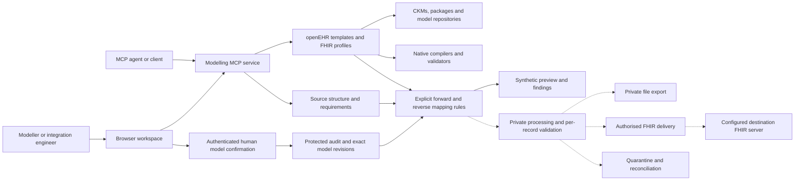

# openEHR and FHIR Modeller

Build reusable clinical models and explicit mappings from source data to openEHR
and FHIR. Use an MCP agent or the browser workspace to inspect source definitions,
reuse archetypes and profiles, author templates, compile models and review the
rules that will transform records. FHIR is the primary exchange output; incoming
FHIR needs its own explicit mapping to openEHR.

For clinical modellers, interoperability engineers and integration teams. The
modeller helps develop and validate interoperability specifications; the existing
governance platform remains responsible for publication and distribution.

Independently maintained and developed by Michael Anywar. Licensed under the
[MIT License](LICENSE); see [third-party notices](THIRD_PARTY_NOTICES.md).

## What you can use it for

- Discover and reuse openEHR archetypes/templates and exact-version FHIR packages.
- Draft openEHR templates and FHIR profiles, compile them with the installed
  engines, validate results and retain their provenance and revisions.
- Supply existing templates and StructureDefinitions when modelling is unnecessary.
  The agent needs the actual model content and version, not just its name.
- Inspect synthetic CSV/custom JSON, identify missing information and preview
  explicit source → openEHR representation → FHIR mapping rules.
- Define a separate FHIR → openEHR mapping and check declared round-trip invariants.
- Browse projects, discuss proposals with an agent and submit models for human review.

The complete operational workflow also requires private source extraction,
validated compositions, resumable transformation runs, file export and delivery to
an authorised FHIR destination. Those capabilities must not be inferred from
model authoring or a successful synthetic preview. See the status table below.

## Open the workspace or connect your agent

| Access | Production | Shared development |
|---|---|---|
| Browser | [Open workspace](https://openehr-fhir-modeller.sandbox.hygeoniq.com/chat/) | [Open Dev workspace](https://dev-openehr-fhir-modeller.sandbox.hygeoniq.com/chat/) |
| MCP endpoint | `https://openehr-fhir-modeller.sandbox.hygeoniq.com/mcp` | `https://dev-openehr-fhir-modeller.sandbox.hygeoniq.com/mcp` |

- `guide_search` finds relevant bundled modelling guidance.
- `guide_get` returns the full content of a selected guide.

Use your deployment's sign-in and assigned project permissions. For an external
MCP client, configure the endpoint and administrator-provided authentication;
never put credentials in a prompt or repository. Dev access can require the
organisation's network and private CA. See [client setup](docs/MCP_CLIENTS.md),
[browser setup](docs/BROWSER_CHAT.md) and [workspace guide](docs/BROWSER_WORKSPACE.md).

Production runs on `hygeoniq-prod`; `amcdr-vps` provides the public HTTPS edge.
[Production delivery and rollback](docs/FHIR_PRODUCTION_DELIVERY.md) describes the
verified-image promotion process.

## Your first workflow: laboratory results

1. **Define the exchange.** Create/select a FHIR project, choose the release
   (R4, R4B or R5), and pin the required IG/package versions. Explain what each
   source record represents, its identifiers, units, terminology and time zone.
2. **Inspect a synthetic source.** Provide a small CSV or JSON fixture and its
   data dictionary. Ask the agent to report structure, missingness and unresolved
   clinical meanings. Keep real patient records in the private processing runtime.
3. **Reuse or model openEHR.** Search configured CKMs first. Supply an existing
   template or author and compile a draft from pinned archetypes. Inspect exact
   nodes and constraints; compilation is a technical check.
4. **Reuse or model FHIR.** Supply the actual StructureDefinitions from the chosen
   IG, or draft and compile profiles. Preserve canonical URLs, versions,
   dependencies, terminology and the original source.
5. **Review model selection and rules.** Both standards must be present before
   mapping. Agent-modelled templates and profiles require human confirmation.
   Externally sourced models must be supplied with their content and provenance.
   Inspect mappings, assumptions, missing/null behaviour and information loss.
   A changed source or model invalidates its earlier pins.
6. **Preview and validate.** Execute explicit rules on synthetic records, inspect
   rejected/unmapped fields, then run the actual applicable validators. A preview
   alone does not prove openEHR composition or FHIR profile conformance.
7. **Process and deliver when qualified.** A complete run must validate records,
   quarantine failures, reconcile counts and preserve provenance. Export is
   separate from a write to a clinical system. Pushing FHIR requires an authorised,
   configured destination and explicit delivery policy; a preview never sends data.

Start with this request in browser chat or your connected MCP agent:

> Help me model laboratory results for FHIR R4 using the IG/package versions I
> supply. Inspect my synthetic CSV and dictionary. Search for reusable archetypes,
> templates and profiles before drafting. Show unresolved meanings and proposed
> rules. Use the exact templates and StructureDefinitions I provide, and obtain
> human confirmation for agent-modelled ones before mapping. Preview the forward
> mapping and a separately defined reverse mapping. Report actual validator
> evidence, unmapped fields and information loss. Do not process patient data or
> send resources to a destination from this preview.

For a reproducible first tool call and expected results, follow the
[laboratory walkthrough](docs/workflows/source-to-fhir-laboratory.md).

## Available today and remaining work

This table describes implemented behaviour, rather than the intended final scope.
The detailed [capability matrix](CAPABILITIES.md) and
[source-driven implementation status](docs/SOURCE_MODELLING.md) are authoritative.

| Capability | Current scope |
|---|---|
| openEHR modelling | CKM discovery, versioned repositories, template authoring, native ADL/OPT validation and supported template compilation |
| FHIR modelling | R4/R4B/R5 packages, profile proposals, real SUSHI compilation, validator evidence, examples and IG draft handoff |
| Source understanding | Bounded synthetic CSV/custom JSON inspection; unresolved meanings are reported |
| Executable mapping | Explicit synthetic forward and separate reverse previews; unmapped fields and rejected records are reported |
| Model review | Protected human openEHR review and exact cross-standard mapping-selection confirmation |
| Operational extraction/runs | Not yet delivered; previews are not processing jobs |
| Export and FHIR destination push | Required operational capability; not yet delivered by the preview engine |
| Other connectors | Folder/XLSX/SQL, incoming FHIR extraction, HL7 v2/CDA and dataset adapters remain implementation work |
| C#/.NET migration | First independent guide service in [PR #17](https://github.com/CzarMich/openehr_FHIR_Modeller/pull/17); full application remains on the patched PHP runtime |

An openEHR-shaped intermediate object is not automatically a conformant
composition. Unavailable checks are reported as `NOT_EXECUTED`. No agent may grant
clinical approval, and a caller-supplied approval flag is not evidence. CDR
persistence is optional; it must not be required merely to generate FHIR.

## Run an isolated local installation

Requires Docker Engine and Docker Compose with `env_file.required` support.
These commands are for a developer's isolated machine; managed Dev/production use
hosted image builds and immutable image promotion.

```sh
git clone https://github.com/CzarMich/openehr_FHIR_Modeller.git
cd openehr_FHIR_Modeller
cp .env.example .env
docker compose up -d --build
curl --fail http://127.0.0.1:8343/health
curl --fail http://127.0.0.1:8343/ready
```

Connect to `http://127.0.0.1:8343/mcp`. The default listener is local and
unauthenticated. Configure authenticated HTTPS before exposing it; see
[installation](docs/install.md) and [deployment](docs/DEPLOYMENT.md).
The FHIR compiler/validator service and browser have additional setup:
[FHIR setup](docs/FHIR_DEV.md), [FHIR workspace](docs/FHIR_WORKSPACE.md),
[external IG/profile sources](docs/FHIR_EXTERNAL_SOURCES.md).

## How the product fits together

The modelling service supplies deterministic operations independently of any
model provider. The browser workspace and external MCP clients use the same
modelling tools. Human model confirmation uses a separate authenticated API.
The operational design applies reviewed mappings in a private runtime, validates
outputs, and exports or pushes FHIR to a configured, authorised destination.



Solid paths describe implemented modelling/preview capabilities; dashed paths
identify the operational processing, export and destination-delivery path still
being implemented. Neither a diagram nor a successful preview is deployment
or conformance evidence.

The [architecture](docs/ARCHITECTURE.md), [identity/access](docs/IDENTITY_AND_ACCESS.md)
and [security](docs/SECURITY.md) guides describe these boundaries. The
[.NET migration status](docs/DOTNET_MIGRATION.md) records the actual runtime
transition; it does not change the model-confirmation or data-delivery contract.

## Learn more

- **Users:** [laboratory walkthrough](docs/workflows/source-to-fhir-laboratory.md),
  [browser workspace](docs/BROWSER_WORKSPACE.md), [tool catalogue](docs/MCP_TOOLS.md).
- **Modellers:** [imports](docs/MODEL_IMPORTS.md), [template compilation](docs/OPT_COMPILATION.md),
  [supported OET profile](docs/LEGACY_OPT_COMPILATION.md), [governance](docs/GOVERNANCE.md).
- **Operators:** [configuration](docs/CONFIGURATION.md), [identity/access](docs/IDENTITY_AND_ACCESS.md),
  [security](docs/SECURITY.md), [Dev delivery](docs/FHIR_DEV_DELIVERY.md),
  [production promotion/rollback](docs/FHIR_PRODUCTION_DELIVERY.md).
- **Contributors:** [architecture](docs/architecture.md), [requirements](docs/requirements.md),
  [traceability](docs/traceability.md), [.NET migration](docs/DOTNET_MIGRATION.md),
  [testing](docs/testing.md), [contribution guide](CONTRIBUTING.md).

Run PHP/Composer in Docker. `make ci` checks traceability, PHPStan and PHPUnit;
`make conformance` checks the advertised HTTP/stdio MCP profile. Build application
images on hosted CI for managed environments. The [documentation index](docs/README.md)
links the remaining references.
