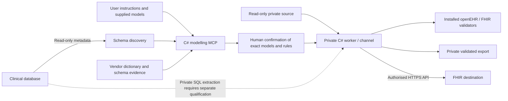

# openEHR Modeller

Discover clinical source structures, build reusable clinical models, and define explicit mappings from source data to openEHR and FHIR. Use an MCP agent or the browser workspace to inspect source definitions,
reuse archetypes and profiles, author templates, compile models and review the
rules that will transform records. Choose independently between source → FHIR,
source → openEHR, openEHR → FHIR and FHIR → openEHR. Each route needs its own
reviewed rules and applicable approved models.

For clinical modellers, interoperability engineers and integration teams. The long-term direction is a standards-based platform for clinical data discovery, cleansing, terminology enrichment, mapping and delivery across healthcare settings. Connector availability, clinical acceptance, terminology licensing, localisation and operational qualification must be established for each deployment; this is not a claim of universal coverage or certification. The
modeller helps develop and validate interoperability specifications; the existing
governance platform remains responsible for publication and distribution.

Independently maintained and developed by Michael Anywar. Licensed under the
[MIT License](LICENSE); see [third-party notices](THIRD_PARTY_NOTICES.md).


## Golden rule: clinical databases are read-only

**Every direct clinical/source database connection is read-only.** The MCP, agents,
workers and channels must never insert, update, delete, alter schemas, run source
migrations or invoke write-capable procedures. Use database-enforced read-only permissions and closed connector operations; fail closed when the connector cannot verify the required restrictions.
FHIR and openEHR delivery use separately authorised HTTP APIs, never their backing databases.
See [the clinical database policy](docs/CLINICAL_DATA_READ_ONLY.md).

Database metadata discovery and private source extraction are separate operations. The vendor adapters support SQL Server, Oracle, PostgreSQL, MySQL, MariaDB and SAP HANA, plus Epic Clarity/FHIR and approved clinical/BW APIs. Private reads require a separately reviewed source configuration and plan; metadata tools never return clinical rows. See [database discovery and driver qualification](docs/DATABASE_DISCOVERY.md).
Browser chat can send chosen conversation context to your configured AI provider.
Keep patient records out of chat, model repositories and general MCP requests.
Filesystem model/history data is not generally encrypted by the application;
volume/backup encryption and retention are operator responsibilities. External
HTTPS does not imply encryption on every private service hop. See the
[security/privacy control matrix](docs/SECURITY.md#security-and-privacy-control-matrix).

## Select a clinical source

Create an explicit source-discovery job: choose the database or platform/API connector, an operator-managed profile, purpose and original narrative. The catalogue includes SQL Server, Oracle, PostgreSQL, MySQL, MariaDB and SAP HANA, plus Epic, SAP BW and configured clinical APIs. Each choice reports its own implementation and qualification status; selection alone does not make a connector operational. Use **Integration → Vendor connections** for encrypted connection settings, metadata discovery, read-plan review and private capture. Native drivers are included except the operator-installed licensed HANA ODBC client. Actual installation qualification remains mandatory. See [vendor integration setup and use](docs/VENDOR_INTEGRATIONS.md) and [source jobs and connector status](docs/SOURCE_CONNECTORS.md).

## HL7 and patient identity

The clinical runtime provides bounded HL7 v2 ER7/XML and supplied-profile HL7 v3/CDA file intake. It includes private durable holding for missing Patients/Encounters, reviewed logical or literal FHIR references, a mandatory verified patient-identity gate and optional destination pseudonymisation. A network MLLP listener/ACK exchange, universal v3 interaction support and full CDA Schematron validation are not implemented. Availability requires promotion of the exact validated images; each installation still needs interface qualification. See [HL7 support, dependencies and patient identity](docs/HL7_AND_IDENTITY.md) for the actual implementation status and qualification requirements.

## Reuse work and reduce AI calls

The workspace provides a deterministic **Find existing work without AI** action in the Integration workspace. It searches saved drafts and currently confirmed mappings using the source identity/meaning version, schema, purpose, original requirements, exact models, terminology pins and runtime. Loading an existing mapping requires no new generation. Human corrections become new versioned proposals for confirmation; they are not silently promoted into approved rules.

Encrypted model-read caching and private task checkpoints also reduce repeated retrieval and recovery work. Reuse never caches an approval decision: access, exact models and current confirmation are checked again. Patient records and credentials do not belong in project memory or AI training. See [reuse, learning and credit controls](docs/REUSE_AND_LEARNING.md) for the workflow, invalidation rules, privacy and implementation status. Check the deployed revision before relying on a source-tree capability.

## What you can use it for

- Discover and reuse openEHR archetypes/templates and exact-version FHIR packages.
- Draft openEHR templates and FHIR profiles, compile them with the installed
  engines, validate results and retain their provenance and revisions.
- Supply existing templates and StructureDefinitions when modelling is unnecessary.
  The agent needs the actual model content and version, not just its name.
- Discover actual allowed database schemas, tables, columns and keys without returning patient rows to an agent. Use the installation’s dictionary and user guidance to resolve clinical meaning.
- Use local terminology catalogues or configured FHIR terminology services to investigate codes, value sets and mapping candidates.
- Inspect synthetic CSV/custom JSON, identify missing information and preview
  the four independent mapping routes without an implicit intermediate standard.
- Define a separate FHIR → openEHR mapping and check declared round-trip invariants.
- Browse projects, discuss proposals with an agent and submit models for human review.

## Run clinical integrations

Use **Integration** to configure a reviewed database/API source, private files or Kafka topic, then have the agent draft rules from your plain-language constraints and supplied models. Suitable sample inputs support proposed test cases and expected outputs. A human reviews and confirms the proposal before assigning it to a channel. Choose strict FIFO, dependency-aware sequential execution or bounded concurrency, and set queue, managed-memory and retry limits. Durable input receipts, private snapshots, dependency holding and output checkpoints survive restarts and prevent completed inputs from being processed again on that channel.

Deliver validated outputs to a separately authorised FHIR or openEHR HTTPS destination. FHIR uses conditional create. openEHR uses patient-EHR verification, parameterised AQL business-identity lookup, qualified stable-UUID creation and authorised version-conditional PUT. Unknown delivery outcomes require reconciliation rather than blind retry. Deterministic processing and exact-context mapping checkpoints avoid language-model calls per record.

Read the [integration configuration and operations guide](docs/INTEGRATION_ENGINE.md) for **polling, Kafka acknowledgment, duplicate prevention, FIFO/concurrency, memory, retries, recovery and monitoring**, including installation qualification limits. This is not a claim of universal exactly-once delivery or parity with mature integration-engine products.

## Open the workspace or connect your agent

| Access | Production | Shared development |
|---|---|---|
| Browser | [Open workspace](https://openehr-fhir-modeller.sandbox.hygeoniq.com/chat/) | [Open Dev workspace](https://dev-openehr-fhir-modeller.sandbox.hygeoniq.com/chat/) |
| MCP endpoint | `https://openehr-fhir-modeller.sandbox.hygeoniq.com/mcp` | `https://dev-openehr-fhir-modeller.sandbox.hygeoniq.com/mcp` |

- `guide_search` finds relevant bundled modelling guidance.
- `guide_get` returns the full content of a selected guide.

Use your deployment's sign-in and assigned project permissions. For an external
MCP client, configure the endpoint and administrator-provided authentication;
never put credentials in a prompt or repository. Dev access can require the
organisation's network and private CA. See [client setup](docs/MCP_CLIENTS.md),
[browser setup](docs/BROWSER_CHAT.md) and [workspace guide](docs/BROWSER_WORKSPACE.md).

Production runs on `hygeoniq-prod`; `amcdr-vps` provides the public HTTPS edge.
[Production delivery and rollback](docs/FHIR_PRODUCTION_DELIVERY.md) describes the
verified-image promotion process.

## Process data or assign a channel

Open the **Integration workspace** link in the browser. Create a project with a pinned FHIR release and dependencies. Provide the actual StructureDefinitions and templates, prepare versioned mapping JSON with your original instructions and synthetic examples, then inspect and confirm the exact model/rule selection.

Upload a private file or select a registered folder. Inspect its field schema, select the confirmed mapping and choose **Validate and export** or an authorised FHIR destination. Review the run before confirming. For continuous consumption, create a channel assignment and explicitly start it. Review counts, failures, private quarantine and validated exports under Jobs. Changing rules requires a new mapping version and confirmation; channels do not automatically adopt new drafts. See [the complete guide](docs/INTEGRATION_ENGINE.md).

## Your first workflow: laboratory results

1. **Define the exchange.** Create/select a FHIR project, choose the release
   (R4, R4B or R5), and pin the required IG/package versions. Explain what each
   source record represents, its identifiers, units, terminology and time zone.
2. **Inspect a synthetic source.** Provide a small CSV or JSON fixture and its
   data dictionary. Ask the agent to report structure, missingness and unresolved
   clinical meanings. Keep real patient records in the private processing runtime.
3. **Provide the source contract.** Define exact fields, identifiers, assigning
   authorities and meanings using the source dictionary. For direct source-to-FHIR,
   no intermediate openEHR template is required.
4. **Reuse or model the target.** Supply the actual FHIR StructureDefinitions from
   the chosen IG, or draft and compile profiles. Preserve canonical URLs, versions,
   dependencies, terminology and the original source. For an openEHR target, supply
   its exact compiled template; a cross-standard route also requires the applicable
   input models. Search existing models before authoring new ones.
5. **Review model selection and rules.** Each independent route needs its applicable input/output models: source-to-FHIR needs target SDs, source-to-openEHR needs its target template, and cross-standard mappings need both.
   Supply external models with content and provenance, then confirm the exact
   models and rules, including agent-modelled proposals. Inspect assumptions,
   missing/null behaviour and information loss. Changes to the declared schema,
   model selection or rules require a new confirmed mapping version; channels
   retain their assigned version.
6. **Preview and validate.** Execute explicit rules on synthetic records, inspect
   rejected/unmapped fields, then run the actual applicable validators. A preview
   alone does not prove openEHR composition or FHIR profile conformance.
7. **Process and deliver when qualified.** A complete run must validate records,
   quarantine failures, reconcile counts and preserve provenance. Export is
   separate from a write to a clinical system. Pushing FHIR requires an authorised,
   configured destination and explicit delivery policy; a preview never sends data.

Start with this request in browser chat or your connected MCP agent:

> Help me model laboratory results for FHIR R4 using the IG/package versions I
> supply. Inspect my synthetic CSV and dictionary. Search for reusable archetypes,
> templates and profiles before drafting. Show unresolved meanings and proposed
> rules. Use the exact templates and StructureDefinitions I provide, and obtain
> human confirmation for agent-modelled ones before mapping. Preview the forward
> mapping and a separately defined reverse mapping. Report actual validator
> evidence, unmapped fields and information loss. Do not process patient data or
> send resources to a destination from this preview.

For a reproducible first tool call and expected results, follow the
[independent laboratory mapping walkthrough](docs/workflows/source-to-fhir-laboratory.md).
Use the [C# integration guide](docs/INTEGRATION_ENGINE.md) for new mappings, private jobs and channels; its model/rule confirmation and run authorisation are separate, request-bound decisions.

## Available today and remaining work

This table describes implemented behaviour, rather than the intended final scope.
The detailed [capability matrix](CAPABILITIES.md) and
[source-driven implementation status](docs/SOURCE_MODELLING.md) are authoritative.

| Capability | Current scope |
|---|---|
| openEHR modelling | CKM discovery, versioned repositories, template authoring, native ADL/OPT validation and supported template compilation |
| FHIR modelling | R4/R4B/R5 packages, profile proposals, real SUSHI compilation, validator evidence, examples and IG draft handoff |
| Source understanding | C# file adapters for CSV, object-array JSON, constrained XML and one-sheet XLSX; FHIR JSON classification requires actual validation before reverse mapping |
| Executable mapping | Versioned narrative-guided rules; source → FHIR, source → openEHR, openEHR → FHIR and FHIR → openEHR as independent reviewed mappings |
| Model review | Protected human openEHR review and exact cross-standard mapping-selection confirmation |
| Operational runs/channels | Optional C# private file workers, checkpointing, quarantine, manual restart and confirmed mapping assignments; previews remain synthetic |
| Export and FHIR destination push | Private NDJSON export; separately enabled HTTPS conditional create by business identifier against an operator-registered FHIR destination |
| SQL Server discovery | Native .NET metadata search, column/key inspection and fingerprint-bound structural plans; clinical rows are excluded from MCP discovery. Private SQL extraction/polling is not yet enabled. |
| Terminology and cleansing | Local catalogues and configured FHIR terminology operations support modelling. Per-record enrichment must be explicit, versioned, reviewed and qualified before execution; no automatic clinical inference is claimed. |
| Other connectors | ODBC/JDBC adapters, HL7 v2, CDA, message queues and specialised dataset adapters require separate implementation/qualification; generic XML does not implement these standards. |
| Application runtime | C#/.NET 10 application services and workers; Node browser and specialised Java/Node standards engines. See [runtime and compatibility](docs/DOTNET_MIGRATION.md). |

An openEHR-shaped intermediate object is not automatically a conformant
composition. Unavailable checks are reported as `NOT_EXECUTED`. No agent may grant
clinical approval, and a caller-supplied approval flag is not evidence. CDR
persistence is optional; it must not be required merely to generate FHIR.

## Run an isolated local installation

Requires Docker Engine and Docker Compose with `env_file.required` support.
These commands are for a developer's isolated machine; managed Dev/production use
hosted image builds and immutable image promotion.

```sh
git clone https://github.com/CzarMich/openehr_FHIR_Modeller.git
cd openehr_FHIR_Modeller
cp .env.example .env
docker compose up -d --build
curl --fail http://127.0.0.1:8343/health
curl --fail http://127.0.0.1:8343/ready
```

Connect to `http://127.0.0.1:8343/mcp`. The default listener is local and
unauthenticated. Configure authenticated HTTPS before exposing it; see
[installation](docs/install.md) and [deployment](docs/DEPLOYMENT.md).
The FHIR compiler/validator service and browser have additional setup:
[FHIR setup](docs/FHIR_DEV.md), [FHIR workspace](docs/FHIR_WORKSPACE.md),
[external IG/profile sources](docs/FHIR_EXTERNAL_SOURCES.md).

## How the product fits together

The modelling service supplies deterministic operations independently of any
model provider. The browser workspace and external MCP clients use the same
modelling tools. Human model confirmation uses a separate authenticated API.
The operational design applies reviewed mappings in a private runtime, validates
outputs, and exports or pushes FHIR to a configured, authorised destination.



File processing, validation, private export and authorised FHIR delivery are implemented operational paths. The dashed database path requires separate private extraction and channel qualification. A diagram or successful synthetic preview does not establish clinical acceptance or identify the image deployed in an environment.

The [architecture](docs/ARCHITECTURE.md), [identity/access](docs/IDENTITY_AND_ACCESS.md)
and [security](docs/SECURITY.md) guides describe these boundaries. The
[runtime and compatibility guide](docs/DOTNET_MIGRATION.md) describes the runtime and preserved data formats; it does not change the model-confirmation or data-delivery contract.

## Learn more

- **Users:** [laboratory walkthrough](docs/workflows/source-to-fhir-laboratory.md),
  [browser workspace](docs/BROWSER_WORKSPACE.md), [tool catalogue](docs/MCP_TOOLS.md).
- **Modellers:** [imports](docs/MODEL_IMPORTS.md), [template compilation](docs/OPT_COMPILATION.md),
  [supported OET profile](docs/LEGACY_OPT_COMPILATION.md), [governance](docs/GOVERNANCE.md).
- **Operators:** [configuration](docs/CONFIGURATION.md), [identity/access](docs/IDENTITY_AND_ACCESS.md),
  [security](docs/SECURITY.md), [Dev delivery](docs/FHIR_DEV_DELIVERY.md),
  [production promotion/rollback](docs/FHIR_PRODUCTION_DELIVERY.md).
- **Contributors:** [architecture](docs/architecture.md), [requirements](docs/requirements.md),
  [traceability](docs/traceability.md), [.NET migration](docs/DOTNET_MIGRATION.md),
  [testing](docs/testing.md), [contribution guide](CONTRIBUTING.md).

Run the .NET domain, protocol, authentication, database-safety and processing checks, together with browser and standards-engine acceptance tests. Build application images on hosted CI for managed environments. The [documentation index](docs/README.md)
links the remaining references.
