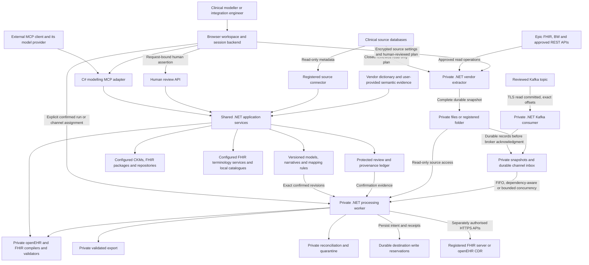
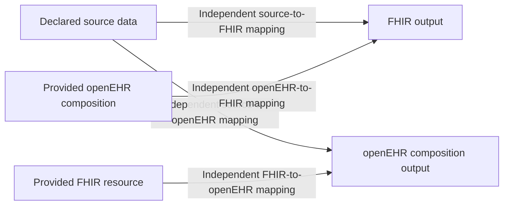

# Architecture

The openEHR Modeller is a C#/.NET 10 application for clinical model development, schema discovery, reviewed mapping and controlled data delivery. MCP and versioned REST adapters call shared application services. The browser supplies human identity, explicit decisions and optional access to a model provider. External MCP clients supply their own model and orchestration. Deterministic record processing does not invoke a language model for each patient record.

The product direction is a standards-based clinical data integration platform. That direction does not establish universal connector coverage, clinical correctness, certification, high availability or suitability for every jurisdiction. Supported operations and acceptance evidence must be evaluated separately from planned capabilities and the revision actually deployed.

## System boundaries

Clinical records and validator findings belong in the private processing boundary. They are excluded from general MCP discovery, model Git, reusable guidance and model-provider context. The optional browser can send chosen conversation content and modelling tool results to its configured provider; users must keep patient records out of that conversation. Metadata and dictionaries can themselves be sensitive and require disclosure authorisation.

## Components and responsibilities

| Component | Responsibility |
|---|---|
| `Modeller.Core` | Shared mapping, source-file contracts, model selection, human-proof and delivery primitives. It does not reference a database driver. |
| `Modeller.Application` | Model repositories, immutable imports, provenance, traceability, standards adapters, terminology, review, private CDR workspace and application policy. |
| `Modeller.Database` | Native/ODBC database and approved vendor API adapters, effective read-only checks, bounded metadata and closed query-plan compiler. No arbitrary SQL or clinical-row MCP operation is exposed. |
| `Modeller.Mcp` | Primary MCP/REST transport, authentication, request bounds, Host/Origin checks, session binding and purpose-bound browser assertions. Its integration workspace mode adapts the existing private model/job workflow. |
| `Modeller.Processing` | Deterministic private file processing, validation, quarantine, export and authorised delivery. Database drivers are outside this worker's dependency graph. |
| `Modeller.Kafka` | Isolated bounded TLS/SASL topic consumer; source identity and exact offsets pinned; commits only after durable private intake. No producer or clinical SQL driver. |
| Node browser backend | Human sessions, private workspace, provider connections, write confirmation and request-bound calls to review/integration adapters. |
| Java openEHR engine | Fixed private content-only inspection, supported ADL/OET compilation, OPT checks and AQL grammar operations. |
| Node/Java FHIR engine | Pinned packages, SUSHI, FHIRPath and actual FHIR validator operations. |
| Caddy ingress | Routes browser and HTTP application traffic on the private service network. The public HTTPS edge is a separate deployment component. |

New application/domain behaviour is implemented in C#. Retaining specialised standards engines does not imply that a structural check establishes clinical validity. The [runtime guide](DOTNET_MIGRATION.md) describes preserved repository, identity and audit formats.

## Explicit source jobs

A source-selection job records the database or platform/API connector, operator profile, project, purpose and original narrative. The catalogue distinguishes SQL Server, Oracle, PostgreSQL, MySQL, MariaDB and SAP HANA databases from Epic, SAP BW, FHIR and other clinical APIs. Connector selection, implemented metadata discovery, driver qualification and clinical extraction are separate states. Unqualified connectors cannot run. See [source jobs and connector status](SOURCE_CONNECTORS.md).

SAP BW discovery must retain analytic grain, dimensions, measures, units, hierarchies and filters. Epic API access requires organisation-approved endpoints, registration and read scopes. Neither platform implies a universal physical database schema.

## Discovery and semantic decisions

Table names are installation-specific. SQL Server discovery reads actual schemas, columns, primary keys and declared foreign keys, supports bounded search/detail pages and produces a deterministic schema fingerprint. Plans use discovered IDs and reject a changed fingerprint, arbitrary SQL, computed columns and unsupported relationships. A declared key is structural evidence; its clinical meaning and join cardinality still require review.

The agent combines metadata, the installation's data dictionary, supplied definitions, user narrative and synthetic examples to propose sources for a resource such as Observation or Condition. It must state unresolved meanings, missing identifiers, uncertain timestamps, terminology dependencies and information loss. It must not invent an ORBIS schema or assume that similarly named fields are clinically equivalent. See [database discovery](DATABASE_DISCOVERY.md).

The implemented SQL tools return metadata only. Private SQL extraction, consistent snapshot policy, bounded polling, stable watermarks and source-to-channel checkpoint semantics are separate capabilities and must be qualified before a database channel is enabled. ODBC and vendor JDBC adapters require operator-controlled, licensed, checksum-pinned drivers and independent acceptance; native SQL Server discovery does not require those adapters.

## Read-only clinical source access

**All direct clinical/source database access is strictly READ ONLY. No agent, MCP call, worker or channel may perform DML, DDL, source migration, permission changes or write-capable procedure execution. There is no override.**

The SQL Server connector requires certificate-validated encryption, an operator-provisioned read-only principal, sufficient metadata visibility and verified effective permissions. It checks server/database/schema/object permissions and column-level grants, fails closed on unsupported permissions and rechecks before discovery. A driver read-only hint is not enforcement. The platform never changes source permissions itself. Actual restrictions also depend on the source administrator maintaining the principal's permissions and isolation.

The platform writes its own model, audit and private operational stores. Those stores must be separate from clinical/source databases. FHIR destination delivery is a separately authorised HTTP API operation with a distinct destination credential. It is not permission to write to the source or to a FHIR server's backing database. See [source database policy](CLINICAL_DATA_READ_ONLY.md) and [security](SECURITY.md).

## Models, narrative rules and confirmation

The original user narrative is retained alongside its proposed interpretation and executable rules. Model content, canonical identity, release/version, dependencies, provenance and exact hashes/revisions form the selection evidence. Supplied external StructureDefinitions/templates must be present in usable form and explicitly confirmed for mapping use. Agent-authored profiles/templates also require user confirmation. Technical validation, model selection, independent clinical approval and publication are different decisions.

Changes to a model, dependency, mapping, interpretation or selection invalidate the corresponding confirmation. A channel pins an exact confirmed mapping; it cannot silently adopt a new draft. Ambiguous rules and unsupported conversions remain findings and block the affected execution. Reverse FHIR-to-openEHR mapping is defined separately; a forward mapping does not prove reversibility.

Human decisions use a purpose-specific API. The browser backend signs short-lived method, raw-target and body-hash assertions after verified human authentication. Persistent one-time nonces prevent replay. Ordinary MCP API keys, bearer tokens and role flags do not turn an agent into a human reviewer. The protected ledger records the exact decision subject and sequence. See [identity and access](IDENTITY_AND_ACCESS.md) and [governance](GOVERNANCE.md).

## Persistence and failure handling

Filesystem repositories preserve project snapshots, artifact history and immutable original bytes using exclusive locks, compare-and-swap revisions and atomic replacement. Git stores native files and metadata with commit revisions and controlled non-force remote operations. SharePoint uses immutable candidates and a conditional project-index update. Repository content is untrusted and cannot manufacture protected provenance or approval.

The protected SQLite/PostgreSQL ledger retains ordered events, sequence checks, hash-chain validation, append-only controls and replay nonces. It is separate from model Git. These controls do not protect against an administrator who can replace the database and recalculate its history; backups and external trust controls remain necessary.

Private jobs retain progress, reconciliation, validation evidence and owner-scoped exports. Source files are opened read-only. Delivery uses a registered destination, explicit operator enablement and run authorisation, successful profile validation, business-identifier conditional create and durable receipts. Unknown outcomes require reconciliation. Retries must not become unconditional creates or duplicate clinical records. See [integration operations](INTEGRATION_ENGINE.md).

## Terminology and clinical data quality

Local versioned catalogues and configured FHIR terminology services support lookup, code validation, expansion and translation during modelling. Canonical identifiers are identifiers, not arbitrary URLs to fetch. Terminology results are evidence and mapping candidates; ambiguous or inexact translations do not automatically become approved rules.

A production cleansing/enrichment rule must identify its exact inputs, normalisation, terminology system/version, concept-map relationship, provenance and failure policy. It must preserve original values privately and define quarantine or an explicitly reviewed fallback. Date formats, time zones, units and clinical codes must not be guessed. External terminology requests should contain only the necessary codes and identifiers, without patient free text. Per-record terminology enrichment and additional clinical normalisers require separate implementation and acceptance before being advertised as an executable channel capability.

## Deployment and evidence

Managed application images are built on hosted CI and promoted by immutable digest. Production application pods run on `hygeoniq-prod`; `amcdr-vps` supplies the public HTTPS edge. Promotion must preserve persistent volumes, secrets, human accounts and stable identity issuers, and update HTTP probes with the application image. See [production delivery](FHIR_PRODUCTION_DELIVERY.md).

Acceptance includes domain/security checks, HTTP/stdio MCP contracts, OIDC/TLS and human-assertion tests, actual standards-engine fixtures, private processing/delivery tests and an isolated SQL Server permission fixture. Write-denial probes run only against a disposable synthetic SQL Server, never against clinical data. Passing synthetic tests does not establish real-installation clinical acceptance, universal interoperability, regulatory certification or absence of vulnerabilities.

## Governed memory and deterministic reuse

Mapping reuse is a `Modeller.Core` registry operation, exposed through the C# MCP and request-bound browser API. It compares a declared source identity/meaning version and purpose with exact source schema, original requirement text/basis, model keys, terminology snapshot pins and runtime fingerprint. It verifies model/definition identities and the protected current confirmation chain on every match. It does not call a model provider or cache an approval. Operational source checking, instance validation and destination authorisation still execute independently.

The browser's encrypted immutable model cache and private task checkpoints are separate from that authoritative registry. They support retrieval/recovery and cannot grant execution or clinical approval. Human corrections become versioned proposals; only confirmed exact-context work is eligible for reuse. Patient records and credentials are excluded from reusable modelling memory and model-provider training. See [reuse and learning](REUSE_AND_LEARNING.md).

## Independent clinical mapping routes

A channel selects exactly one independently confirmed mapping: **source → openEHR**, **source → FHIR**, **openEHR → FHIR**, or **FHIR → openEHR**. Source-to-FHIR does not create or validate an intermediate openEHR composition. Input and output standards determine the exact templates/profiles required. No old confirmed two-stage definition is silently reinterpreted; see [ADR-0031](decisions/0031-independent-clinical-routes-and-identity.md).

`Modeller.Operational` owns bounded HL7 parsing/projection, supplied source-profile checks, encrypted internal patient identities, stable pseudonyms and durable dependency state. Its SQLite store is private platform storage, never a clinical source database. Source connections remain read-only without an override. Private workers require an exact confirmed source contract and patient policy. Source registration requires separate explicit trust; a patient number in an arbitrary record is insufficient. Verified destination reads establish Patient/Encounter relationships before dependent delivery. Held inputs retain their encrypted originals; dependency-aware channels can accept eligible later messages, whereas strict FIFO blocks behind the held head. An uncertain write requires reconciliation rather than automatic repetition.

The feature branch's runtime/adapter and installation acceptance must pass before these changes are described as deployed. [HL7 and identity operations](HL7_AND_IDENTITY.md) records the tested formats, profile scope and transport limitations.

## Vendor source adapter boundary

The separate C# `Modeller.Extraction` executable owns native/ODBC clinical-source drivers and approved HTTP read adapters. Browser `VendorSources` protects encrypted owner/project-scoped profiles, fresh human review, immutable read-plan/runtime pins and atomic private intake publication. General MCP exposes metadata only. A source read is independent of model/mapping confirmation and destination delivery. SQL Server private extraction requires existing snapshot isolation; the platform never enables it or changes source permissions. SAP HANA requires the installed licensed, checksum-pinned client.

Read-only database snapshots and explicitly reviewed append-only streams feed the existing private processing worker. Exact cursor JSON avoids JavaScript numeric rounding; cursor advancement follows durable captured bytes and manifests. API response pages are encrypted and hash-linked. Foreign-origin/unapproved paging, incomplete windows, drift and unsupported permissions fail closed. The four mapping routes and mandatory patient/dependency policy remain unchanged. See [vendor integrations](VENDOR_INTEGRATIONS.md) for actual scope, setup, acceptance and limits.

## Durable integration execution

The private inbox uses SQLite WAL/synchronous commits and retained per-input snapshots. Transport identity (file content hash or Kafka cluster/topic UUID/partition/offset) is separate from clinical business identity and source version. Strict FIFO can block behind missing patients; dependency-aware mode lets eligible later inputs proceed; bounded concurrency admits at most two private compute workers globally. Managed heap settings do not bound total RSS.

Internal target reservations serialize openEHR writes across platform profiles sharing a stable physical-CDR namespace. AQL detects existing business identities; qualified client-assigned UUIDs protect creation; PUT requires explicit authorisation and exact If-Match. An unknown mutation remains fenced across restart until human reconciliation. FHIR conditional-create semantics remain separate. Clinical/source databases remain strictly read-only; Kafka commits change group coordination metadata only. See [the integration runbook](INTEGRATION_ENGINE.md) and [ADR-0033](decisions/0033-durable-clinical-integration.md).
